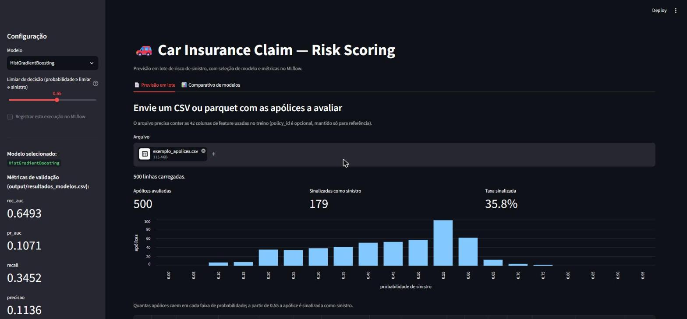
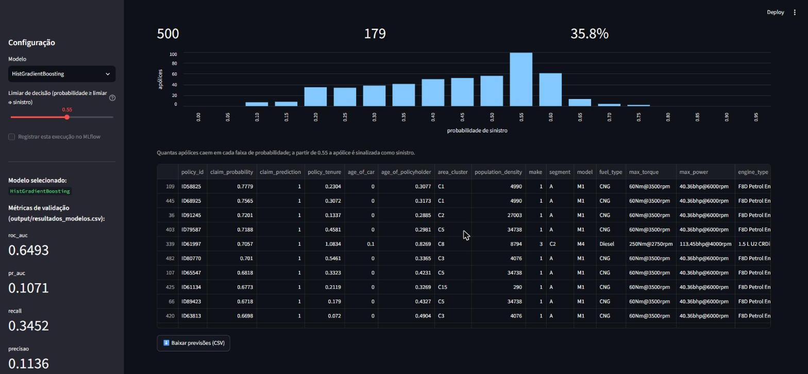
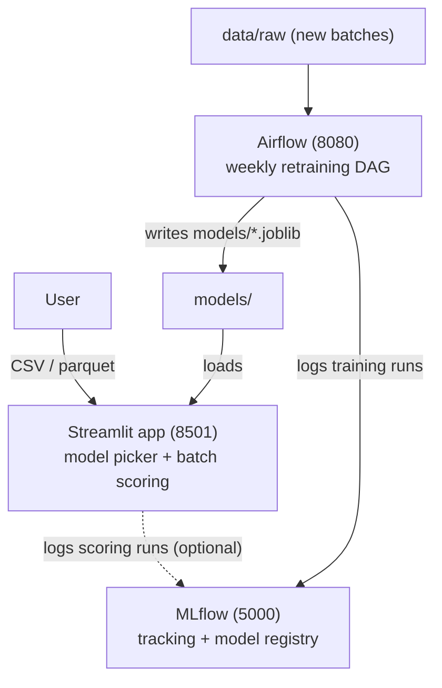

<h1 align="center">MLOps · Car Insurance Claim Prediction</h1>

<p align="center">
  A Streamlit app that scores car insurance policies in batch and flags the ones most likely to file a claim in the next 6 months,<br/>
  packaged for deployment with <b>Streamlit Community Cloud</b>, <b>Docker</b>, <b>MLflow</b> and <b>Airflow</b>.
</p>

<p align="center">
  
  
  
  
  
  
  
</p>

<p align="center">
  
  
  
  <a href="LICENSE"></a>
  <a href="https://github.com/RafaelGallo/car-insurance-claim-prediction"></a>
  
</p>

<p align="center">
  
</p>

---

## Table of contents

- [What this repository is](#what-this-repository-is)
- [App features](#app-features)
- [How to use the app](#how-to-use-the-app)
- [Input file format](#input-file-format)
- [Output columns](#output-columns)
- [Available models](#available-models)
- [Reading the score](#reading-the-score)
- [Run locally](#run-locally)
- [Deploy on Streamlit Community Cloud](#deploy-on-streamlit-community-cloud)
- [Run the full stack with Docker](#run-the-full-stack-with-docker)
- [MLOps architecture](#mlops-architecture)
- [Project structure](#project-structure)
- [Known limitations](#known-limitations)
- [License](#license)

## What this repository is

This is the deployment repository of the [**Car Insurance Claim Risk Prediction**](https://github.com/RafaelGallo/car-insurance-claim-prediction) project. It ships everything the Streamlit app needs to run on its own — the trained models (`models/*.joblib`), the shared Python package (`car_insurance_claim/`) and the app (`app/streamlit_app.py`) — plus the Docker, MLflow and Airflow setup of the full MLOps stack.

The business problem: an auto insurer needs to know, at issuance and renewal, how likely each policyholder is to file a claim in the next 6 months. Only **6.4%** of the 58,592 policies in the training data filed a claim, so the score is used to rank policies for risk-based pricing and for manual review / fraud-risk triage. The full analysis (EDA, model comparison, GLM study) lives in the notebooks and in the main repository.

## App features

- **Batch scoring:** upload a CSV or parquet file with any number of policies and score them all at once.
- **12 models to choose from:** 10 tree/boosting and linear models plus 2 tuned HistGradientBoosting pipelines.
- **Adjustable decision threshold:** defaults to the business threshold of **0.55** saved in `models/limiar_negocio.joblib`.
- **Summary at a glance:** number of policies scored, number and share flagged as claim, and a histogram of the score distribution.
- **Risk-ranked results:** the table starts with `policy_id`, score and prediction, sorted from highest to lowest risk.
- **Download:** export the scored file as CSV, in the same risk order.
- **Model comparison tab:** validation metrics of the 10 production models and of the 5 GLM baselines.
- **Optional MLflow tracking:** when an MLflow server is reachable, each scoring run is logged and the sidebar shows the model's latest metrics from MLflow. Without a server, the app works normally and reads the metrics from `output/resultados_modelos.csv`.

## How to use the app

1. Pick a model in the sidebar (default: `HistGradientBoosting`, the best one on validation).
2. Optionally move the decision threshold: a lower threshold flags more policies and catches more claims, at the cost of more false alarms.
3. In **"Previsão em lote"**, click **Browse files** and upload a CSV or parquet file (format below).
4. Read the summary and the histogram, check the riskiest policies at the top of the table, and click **"Baixar previsões (CSV)"** to download the results.

<p align="center">
  
</p>

The app's interface is in Portuguese; the labels map as follows: *Previsão em lote* = batch scoring, *Comparativo de modelos* = model comparison, *Limiar de decisão* = decision threshold, *Apólices avaliadas* = policies scored, *Sinalizadas como sinistro* = flagged as claim.

## Input file format

A CSV or parquet file with one row per policy and the **42 feature columns** used in training (column order does not matter). `policy_id` is optional and is kept only to identify the rows; any extra column is carried through to the output untouched. The Kaggle dataset's `test.csv` ([`ifteshanajnin/carinsuranceclaimprediction-classification`](https://www.kaggle.com/datasets/ifteshanajnin/carinsuranceclaimprediction-classification)) has exactly this format.

| Type | Columns |
|---|---|
| **Numeric (15)** | `policy_tenure`, `age_of_car`, `age_of_policyholder`, `population_density`, `make`, `airbags`, `displacement`, `cylinder`, `gear_box`, `turning_radius`, `length`, `width`, `height`, `gross_weight`, `ncap_rating` |
| **Text (10)** | `area_cluster` (e.g. `C2`), `segment` (e.g. `B2`), `model`, `fuel_type` (e.g. `Petrol`), `max_torque` (e.g. `113Nm@4400rpm`), `max_power`, `engine_type`, `rear_brakes_type`, `transmission_type`, `steering_type` |
| **Yes / No (17)** | `is_esc`, `is_adjustable_steering`, `is_tpms`, `is_parking_sensors`, `is_parking_camera`, `is_front_fog_lights`, `is_rear_window_wiper`, `is_rear_window_washer`, `is_rear_window_defogger`, `is_brake_assist`, `is_power_door_locks`, `is_central_locking`, `is_power_steering`, `is_driver_seat_height_adjustable`, `is_day_night_rear_view_mirror`, `is_ecw`, `is_speed_alert` |

If a required column is missing, the app lists exactly which ones and does not score the file. Category values never seen in training (for example a new `area_cluster`) are mapped to a known category instead of crashing, and a warning is logged.

## Output columns

The downloaded file contains every input column plus:

| Column | Meaning |
|---|---|
| `claim_probability` | Model score between 0 and 1; higher means riskier (see [Reading the score](#reading-the-score)). |
| `claim_prediction` | `1` if `claim_probability` ≥ the chosen threshold, otherwise `0`. |

## Available models

Validation metrics of the 10 production models (`notebooks/model_ml.ipynb`; the base claim rate is 0.064, so a PR-AUC above that beats chance):

| Model | ROC-AUC | PR-AUC | Recall | Precision | F1 |
|---|---|---|---|---|---|
| HistGradientBoosting | 0.6493 | 0.1071 | 0.3452 | 0.1136 | 0.1709 |
| CatBoost | 0.6476 | 0.1062 | 0.3436 | 0.1131 | 0.1701 |
| Random Forest | 0.6417 | 0.1055 | 0.3323 | 0.1093 | 0.1645 |
| Gradient Boosting | 0.6454 | 0.1040 | 0.3323 | 0.1093 | 0.1645 |
| LightGBM | 0.6341 | 0.1018 | 0.2982 | 0.0981 | 0.1477 |
| XGBoost | 0.6371 | 0.1008 | 0.3031 | 0.0997 | 0.1501 |
| AdaBoost | 0.6369 | 0.1003 | 0.3225 | 0.1061 | 0.1597 |
| Decision Tree | 0.6341 | 0.1000 | 0.2950 | 0.0971 | 0.1461 |
| Extra Trees | 0.6199 | 0.0912 | 0.2771 | 0.0912 | 0.1372 |
| Logistic Regression | 0.6125 | 0.0906 | 0.2966 | 0.0976 | 0.1469 |

The app also offers **Pipeline HGB (Busca Aleatoria)** and **Pipeline HGB (Grid Search)**, two HistGradientBoosting pipelines tuned with `RandomizedSearchCV` / `GridSearchCV` in `notebooks/pipeline_ml.ipynb`.

## Reading the score

- **It is a risk score, not a calibrated probability.** The models were trained with class weighting to cope with the 6.4% claim rate, which pushes scores up: a score of 0.79 does not mean a 79% chance of a claim. Use it to **rank** policies.
- **The threshold is a business decision.** With the default 0.55, `HistGradientBoosting` flags about 34% of the 39,063 policies in the Kaggle `test.csv`. Pick the threshold from how many policies the team can actually review.
- **Claims are hard to predict in this data:** the best model reaches a ROC-AUC of about 0.65. The ranking is useful for prioritization, but most flagged policies will not file a claim.

## Run locally

Requires Python 3.12.

```bash
git clone https://github.com/RafaelGallo/MLOps-car-insurance-claim-prediction.git
cd MLOps-car-insurance-claim-prediction
python -m venv .venv
.venv\Scripts\activate          # Windows  (Linux/macOS: source .venv/bin/activate)
pip install -r app/requirements.txt
streamlit run app/streamlit_app.py
```

The app opens at http://localhost:8501. It finds the `car_insurance_claim` package straight from the repository, so no `pip install -e .` is needed.

**Optional — MLflow tracking.** Start a local server in another terminal and point the app at it:

```bash
mlflow server --backend-store-uri sqlite:///mlflow/data/mlflow.db --default-artifact-root ./mlflow/artifacts --port 5000
```

```bash
# Windows PowerShell: $env:MLFLOW_TRACKING_URI="http://localhost:5000"
export MLFLOW_TRACKING_URI=http://localhost:5000
streamlit run app/streamlit_app.py
```

To fill MLflow with the history of the already-trained models, run once from the repository root: `python -m car_insurance_claim.mlops.backfill`.

## Deploy on Streamlit Community Cloud

1. Push this repository to GitHub (it already contains the models and the package the app needs).
2. Go to [share.streamlit.io](https://share.streamlit.io), sign in with GitHub, click **Create app** and choose to deploy from a GitHub repository.
3. Fill in:
   - **Repository:** `RafaelGallo/MLOps-car-insurance-claim-prediction`
   - **Branch:** `main`
   - **Main file path:** `app/streamlit_app.py`
4. Open **Advanced settings** and choose **Python 3.12**.
5. Click **Deploy**. Streamlit Cloud installs the dependencies from `app/requirements.txt`: a dependency file in the entrypoint's folder [takes precedence](https://docs.streamlit.io/deploy/streamlit-community-cloud/deploy-your-app/app-dependencies) over the root one. That matters here, because the root `requirements.txt` is the full Windows development environment and includes `pywin32`, which does not install on Linux.

No secrets or environment variables are needed. There is no MLflow server on Streamlit Cloud, so the app runs without tracking and shows the metrics from `output/resultados_modelos.csv`.

## Run the full stack with Docker

Requires Docker Desktop.

```bash
# Streamlit (8501) + MLflow (5000)
docker compose up -d --build

# fill MLflow with the already-trained models (first time only)
docker compose exec streamlit python -m car_insurance_claim.mlops.backfill

# optional: Airflow (8080, user/password admin/admin) for weekly batch retraining
docker compose -f docker-compose.airflow.yml up -d --build
```

The Airflow DAG `retrain_car_insurance_model` reads the newest CSV/parquet in `data/raw` (falling back to `data/train.parquet`), retrains the 10 models, logs every run to MLflow and overwrites `models/*.joblib`. The training data is not in this repository; download it from Kaggle with `src/data_kaggle.py` (your Kaggle credential goes in `config/kaggle.json`, which is git-ignored).

## MLOps architecture



| Component | Where | Role |
|---|---|---|
| Streamlit app | `app/streamlit_app.py` | Batch scoring UI: model picker, upload, results, download, model comparison |
| Inference | `car_insurance_claim/modeling/predict.py` | Loads a model, applies the training `LabelEncoder`s, scores and applies the threshold |
| Training | `car_insurance_claim/modeling/train.py` | Retrains the 10 models and logs them to MLflow (used by Airflow) |
| MLflow helpers | `car_insurance_claim/mlops/` | Optional tracking (with a fast health check), history backfill, PDF report |
| MLflow server | `docker/mlflow.Dockerfile` | Experiment tracking and model registry (SQLite backend) |
| Airflow | `airflow/dags/` + `docker-compose.airflow.yml` | Weekly batch retraining (webserver + scheduler + Postgres) |

## Project structure

```
├── app/
│   ├── streamlit_app.py       <- Streamlit app (entry point for deployment)
│   └── requirements.txt       <- dependencies used by Streamlit Cloud and the app Docker image
├── car_insurance_claim/       <- shared Python package
│   ├── config.py              <- paths, MLflow tracking URI and experiment name
│   ├── modeling/
│   │   ├── predict.py         <- inference used by the app and the CLI
│   │   └── train.py           <- retraining + MLflow logging, used by Airflow
│   └── mlops/
│       ├── mlflow_utils.py    <- optional MLflow tracking with a fast health check
│       ├── backfill.py        <- logs the already-trained models to MLflow
│       └── generate_report.py <- builds doc/car_insurance_claim_report.pdf
├── models/                    <- 12 trained models (.joblib), label encoders, feature list, business threshold
├── output/                    <- validation results tables shown in the comparison tab
├── airflow/                   <- retraining DAG and its requirements
├── docker/                    <- Dockerfiles (streamlit, mlflow, airflow)
├── docker-compose.yml         <- Streamlit + MLflow
├── docker-compose.airflow.yml <- Airflow + Postgres (optional)
├── mlflow/                    <- MLflow server volumes (data/, artifacts/)
├── notebooks/                 <- EDA, model comparison, tuned pipelines, GLM study
├── img/                       <- EDA charts and app screenshots
├── doc/                       <- project report (PDF, in Portuguese)
├── src/                       <- Kaggle download scripts
├── data/                      <- local data folder (not versioned)
├── requirements.txt           <- full development environment (notebooks included)
└── pyproject.toml
```

## Known limitations

- **Cold start:** the first scoring after the app starts takes about 20–30 seconds while the libraries and the model load; later uploads take a few seconds.
- **Upload size:** Streamlit accepts files up to 200 MB.
- **Data not included:** the Kaggle data is not versioned here; download it to run the notebooks or the Airflow retraining.
- **Scores are not calibrated probabilities** (see [Reading the score](#reading-the-score)).

## License

Distributed under the MIT License. See [`LICENSE`](LICENSE).
